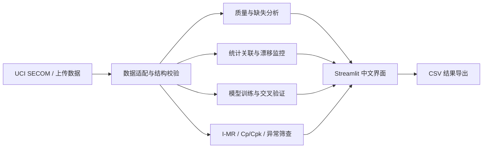

# 半导体工艺数据分析平台

面向半导体 PE、PIE 与 EE 求职展示的工艺数据分析原型。项目同时提供 UCI SECOM 真实公开数据模式和合成工艺质量演示模式，严格区分真实数据、匿名字段与模拟场景。

[](https://github.com/Zhangjiayuan-bug/semiconductor-process-platform/actions/workflows/tests.yml) [](LICENSE)

## 核心功能

- CSV/Excel 文件导入、字段清洗与结构校验
- UCI SECOM 官方数据适配：1,567 个样本、590 个匿名传感器变量
- 数据缺失率、类别分布和传感器分布分析
- Welch t 检验、Benjamini-Hochberg 多重检验校正与标准化效应量
- 防止数据泄漏的类别加权逻辑回归基线
- 平衡准确率、精确率、召回率、ROC-AUC、PR-AUC 和混淆矩阵
- 基于 PSI 与 KS 检验的传感器及工艺批次漂移监控
- 双策略交叉验证：5 折×2 次重复分层 CV + 5 折时间扩展窗口 CV
- 逐折输出训练/测试样本量、失效率、时间边界、PR-AUC 95% 描述性区间，量化 IID 与未来外推落差
- 良率趋势、设备对比与严格 I-MR 控制图
- Western Electric WE-1 至 WE-4 规则和移动极差超限检测
- Cp/Cpk 过程能力分析和规格限校验
- 孤立森林异常筛查
- 随机森林良率影响因素分析
- 可下载的关联分析、漂移、异常和预测结果
- GitHub 参考项目元数据与许可证审计
- 可复现演示数据和自动化测试

## 本地运行

```powershell
python -m venv .venv
.\.venv\Scripts\Activate.ps1
pip install -r requirements.txt
python scripts_generate_demo.py
python scripts_download_secom.py
streamlit run app.py
```

如需更新 GitHub 参考项目元数据：

```powershell
python scripts_github_research.py
```

运行质量门禁：

```powershell
ruff check .
ruff format --check .
pytest --cov=src --cov-branch
```

## 数据与结论边界

- UCI SECOM 模式使用 CC BY 4.0 许可的官方公开数据。
- SECOM 传感器字段已匿名化，不能解释为具体晶圆厂、设备、配方或工艺步骤。
- 统计显著性、效应量、漂移指标和模型输出用于分析筛查，不等同于工艺因果关系或产品放行结论。
- 工艺质量模板使用合成演示数据，其中的设备、良率、规格限和过程能力结果不代表真实生产记录。
- 许可证不明确的 GitHub 代码和晶圆图数据仅用于方法调研，不复制源码、不打包分发。

## 分析架构



核心分析函数位于 `src/analysis.py`，Streamlit 页面只负责交互、可视化和结果导出。昂贵的 SECOM 加载和模型计算使用 `st.cache_data` 缓存。

## 模型验证设计

项目不把单一随机切分结果当成泛化证据，而是交叉验证两类假设：

- **重复分层 CV**：5 折×2 次，在近似 IID 的前提下比较模型排序能力。
- **时间扩展窗口 CV**：按时间排序，以早期记录训练、后续记录测试；同一时间戳不会跨越训练/测试边界，用于模拟未来批次外推。

两种策略复用完全相同的四个模型、指标和预处理流水线；中位数填补、缺失指示、常量特征过滤、标准化和 PCA 均在每个训练折内拟合。结果通过 Streamlit 导出逐折审计 CSV，避免只展示不可复核的均值。

重复分层 CV 的可复现基准结果：

| 模型 | PR-AUC 均值 | PR-AUC 标准差 | 平衡准确率均值 | ROC-AUC 均值 | 召回率均值 |
|---|---:|---:|---:|---:|---:|
| 类别加权随机森林 | 0.201 | 0.052 | 0.500 | 0.724 | 0.000 |
| 类别加权逻辑回归 | 0.154 | 0.046 | 0.566 | 0.656 | 0.236 |
| PCA + 逻辑回归 | 0.131 | 0.036 | 0.560 | 0.623 | 0.289 |
| 先验概率基线 | 0.066 | 0.001 | 0.500 | 0.500 | 0.000 |

随机森林的排序指标更高，但默认 0.5 阈值下未识别失效样本；逻辑回归的 PR-AUC 较低，但具有非零召回率。这说明模型排序能力、分类阈值和业务误判成本必须分别评估，不能仅凭单一指标宣称可部署。时间外推结果用于识别时间漂移风险，不被包装成外部晶圆厂验证。

在同一份真实 SECOM 数据上的时间扩展窗口结果为：随机森林 PR-AUC 0.074、逻辑回归 0.099。相较随机分层结果，随机森林下降约 63%，逻辑回归下降约 36%；该差异被保留为模型风险证据，而不是被隐藏在单一平均分数之后。

## I-MR 方法

Phase I 基准窗口用于估计并冻结控制限。移动极差跨度为 2：

```text
MRᵢ = |xᵢ - xᵢ₋₁|
σ̂ = MR̄ / 1.128
Individuals UCL/LCL = x̄ ± 3σ̂
MR UCL = 3.267 × MR̄
MR LCL = 0
```

Phase II 检测 WE-1（单点超 3σ）、WE-2（连续 3 点中 2 点超同侧 2σ）、WE-3（连续 5 点中 4 点超同侧 1σ）、WE-4（连续 8 点位于中心线同侧）以及移动极差超限。

## 工程质量

- `requirements-lock.txt` 固定直接依赖版本
- `.github/workflows/tests.yml` 在 Python 3.11/3.12 矩阵中运行 Ruff、分支覆盖率和测试；覆盖率门槛为 80%
- SECOM 下载脚本校验 SHA-256，并只解压白名单文件；CI 对数据源使用缓存减少网络不稳定
- Dependabot 自动更新 Python 与 GitHub Actions 依赖，Issue/PR 模板统一提交证据和风险
- `docs/MODEL_CARD.md` 记录模型用途、验证设计和限制
- `docs/RESEARCH_AND_AUDIT.md` 记录数据来源、开源调研和审计边界
- Apache-2.0 许可证
